# 雀 — Browser Hong Kong Mahjong

[](docs/07-infra.md#9-ci)
[](docs/07-infra.md#9-ci)
[](https://www.python.org/)
[](https://fastapi.tiangolo.com/)
[](https://svelte.dev/)
[](https://www.postgresql.org/)
[](LICENSE)

Hong Kong mahjong, browser-native and server-authoritative — full faan scoring, zero client trust.
Play solo against bots tuned from easy heuristics to a self-play RL "Expert."

**Stack:** Python 3.13 / FastAPI (REST + native WebSocket) · SvelteKit 2 + Svelte 5 (runes), DOM + SCSS · Postgres

## Features

- **Full HK ruleset** — faan table, claim priority, payouts, configurable `RuleSet` presets ([01](docs/01-rules-spec.md))
- **Bots from Easy to Impossible** — heuristic tiers, a self-play RL "Expert", and a full-information `ORACLE` ([04](docs/04-bots.md), [06](docs/06-ml.md))
- **Structural anti-cheat** — per-seat redaction; clients never see what they shouldn't ([00 §5, §9](docs/00-architecture.md))
- **Deterministic** — any hand reproduces from `(ruleset, seed, actions)` ([00 §3](docs/00-architecture.md))

## Quick start

Requires Docker + Docker Compose; `make up` builds everything else.

```bash
cp .env.example .env
make up            # postgres + api + web
# web  http://localhost:5173
# api  http://localhost:8000/docs
make help          # everything else
```

## Screenshots

Captured from `/table/[id]`'s frozen mock-scenario fixture (`?mock=`) or its no-socket pre-game
preview (`?pregame=`), not a live game — both repeatable without a running backend, even though
`/table/[id]` itself now opens a real one by default (`docs/03-frontend.md`'s "`/table/[id]`
wiring"). Regenerate with `pnpm --dir web run screenshots` after any visible frontend change (see
`.claude/skills/frontend-screenshots/SKILL.md`).

| | |
| --- | --- |
| 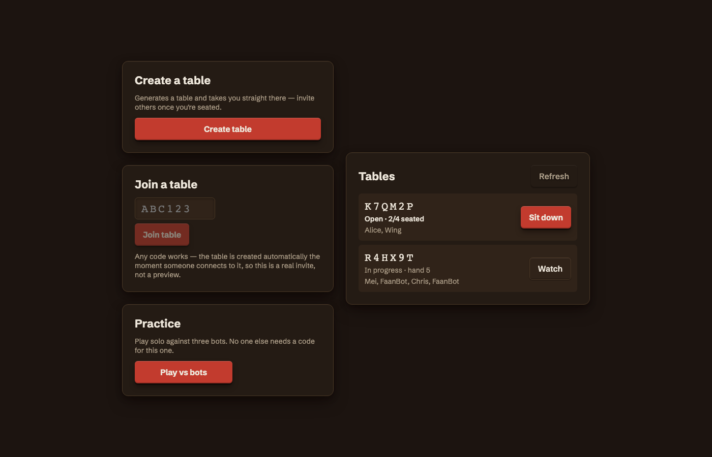 Lobby (`/`) — create a table, join one, or play solo vs bots, over a scrolling tile-mural canvas background | 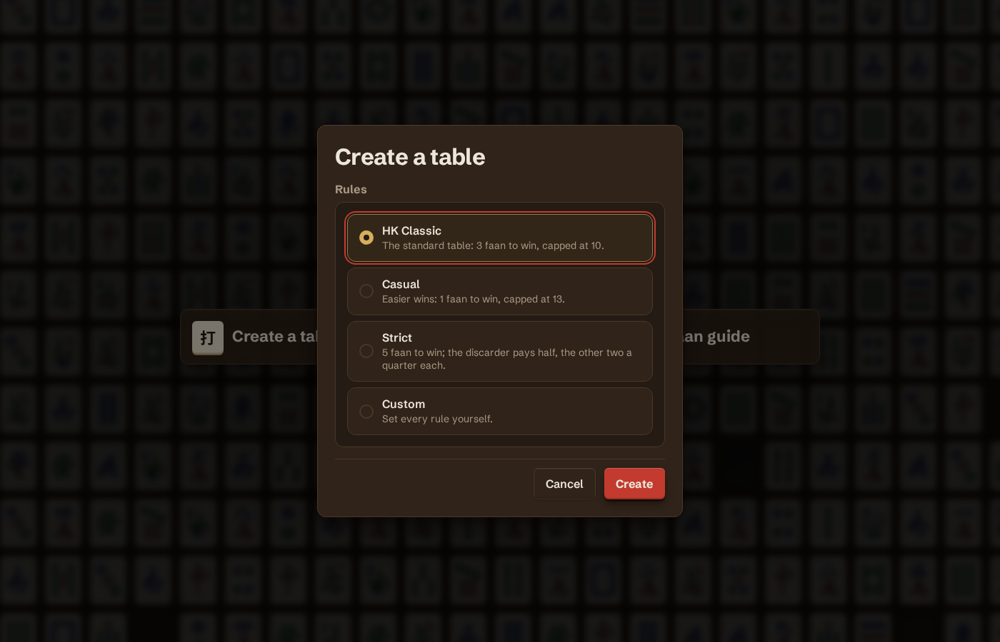 Lobby — create-table dialog: named rules presets or a custom ruleset (`POST /tables`, `docs/02-protocol.md §10`) |
| 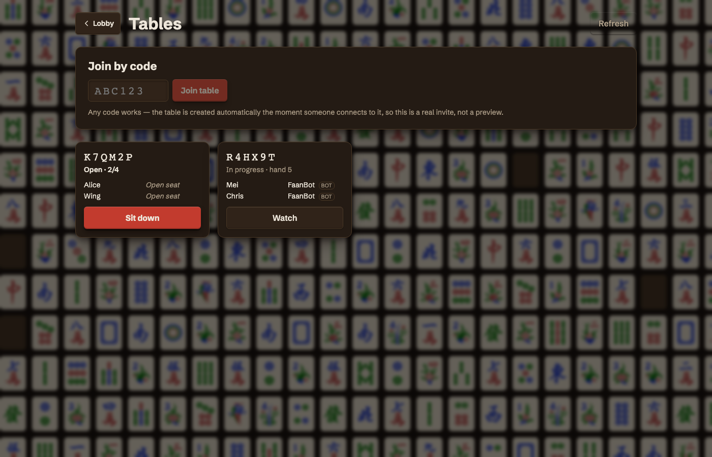 Tables (`/tables`) — join by code, or sit down / watch from the grid | 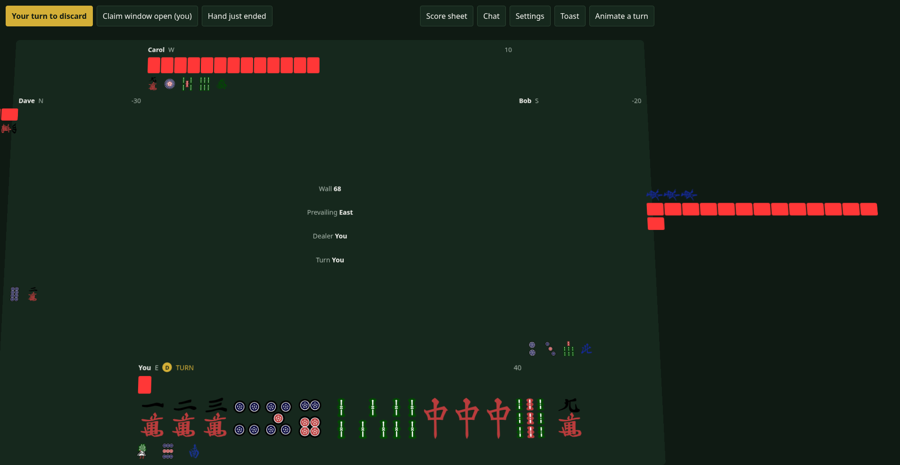 Table — your turn to discard |
| 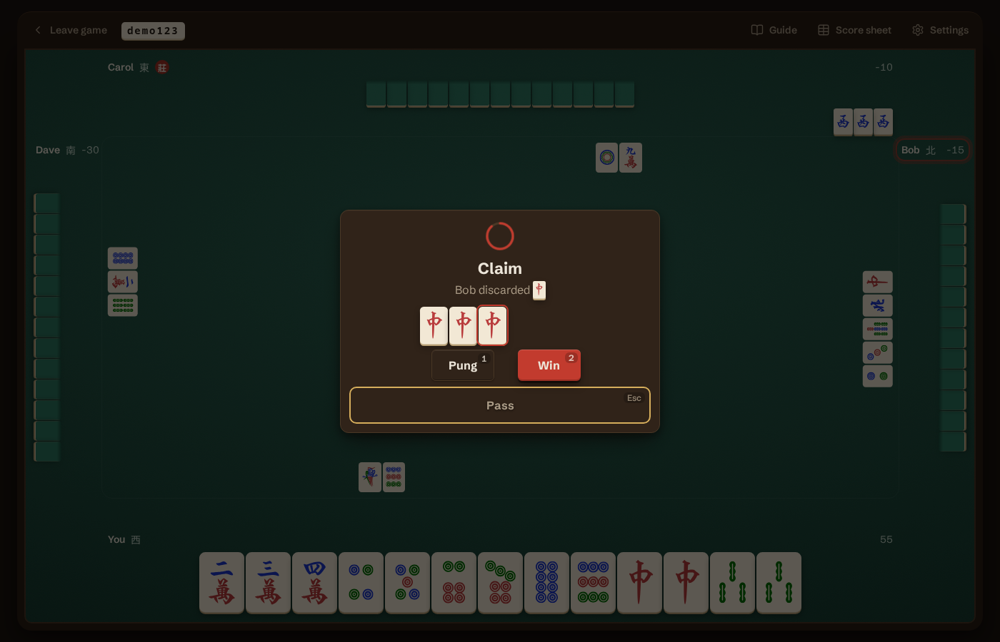 Table — claim window open | 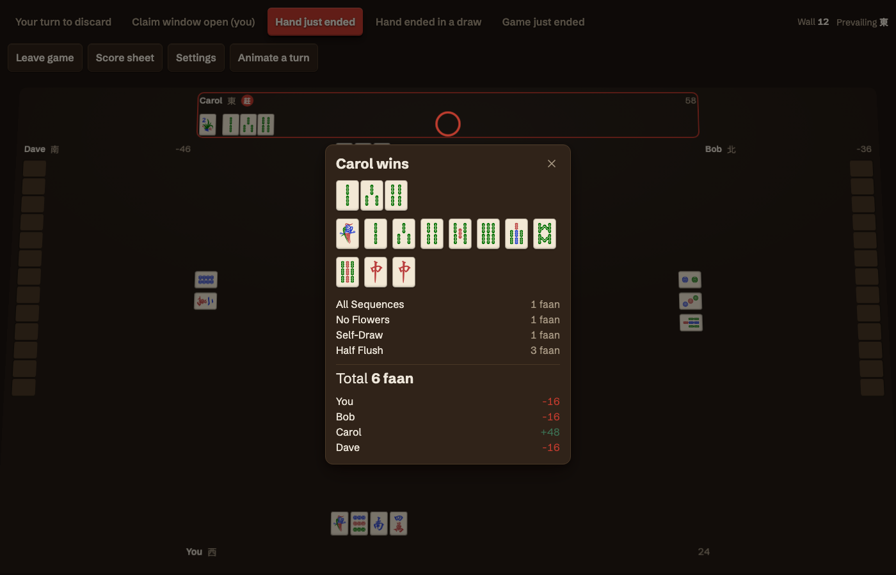 Table — hand ended, faan breakdown |
| 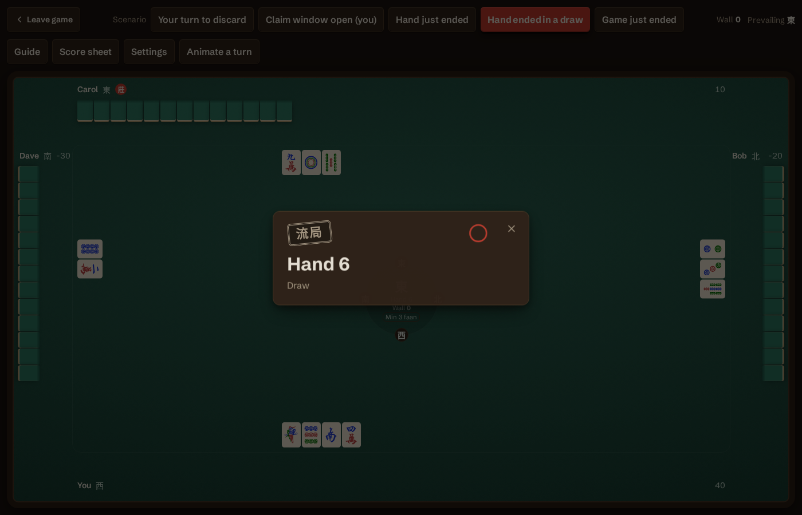 Table — hand ended, exhaustive draw | 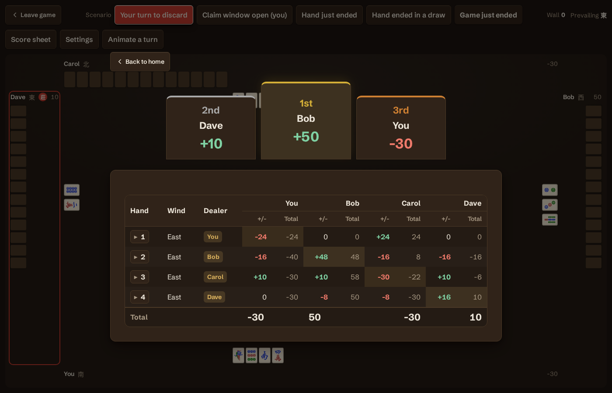 Table — game ended, score summary with winner podium |
| 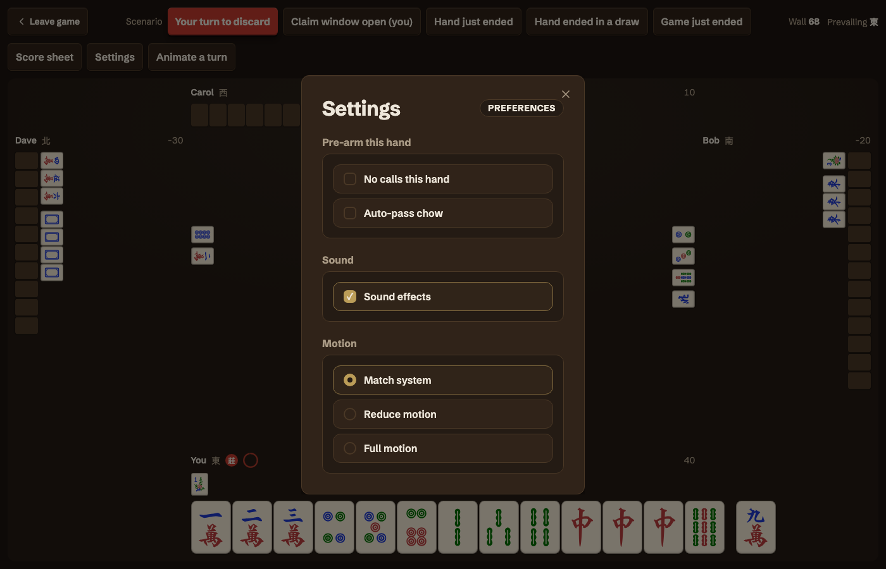 Table — settings panel | 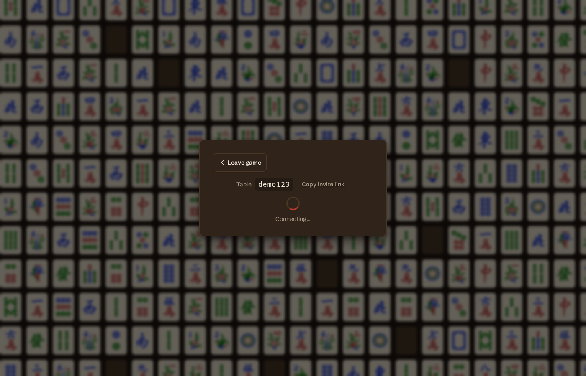 Table — connecting |
| 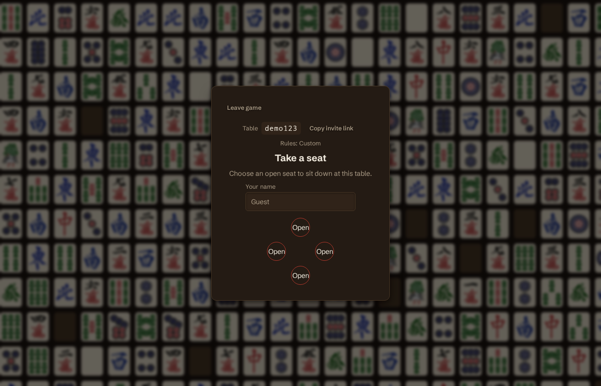 Table — take a seat | 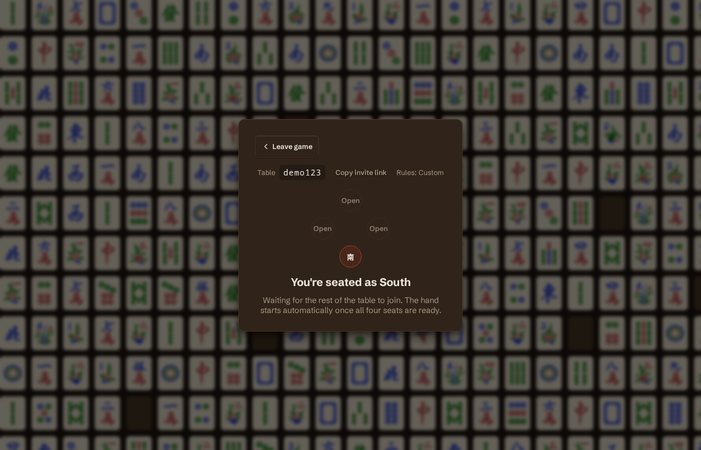 Table — seated, waiting for players |

## Planning docs

| Doc | Contents |
| --- | --- |
| [00-architecture.md](docs/00-architecture.md) | System design, table-as-actor model, scaling path |
| [01-rules-spec.md](docs/01-rules-spec.md) | Tiles, state machine, claim priority, faan table, payouts |
| [02-protocol.md](docs/02-protocol.md) | WebSocket envelope, message catalog, redaction, reconnect/resync, timers |
| [03-frontend.md](docs/03-frontend.md) | Svelte component layout, scene/DOM structure, asset pipeline, interaction model |
| [04-bots.md](docs/04-bots.md) | Bot tiers, shanten/ukeire, HK 3-faan trap, safety play, evaluation harness |
| [05-roadmap.md](docs/05-roadmap.md) | Milestones, testing strategy, risk register, resolved decisions |
| [06-ml.md](docs/06-ml.md) | Self-play RL agent (T4 "Expert"): action encoding, game records, plan and status |
| [07-infra.md](docs/07-infra.md) | Monorepo layout, process model, Docker targets and profiles |
| [09-testing.md](docs/09-testing.md) | Implementation-level testing gotchas (Vitest browser mode, mocking, fixtures) |

## Layout

```
server/   Python. mahjong_core/ (pure rules, stdlib-only) + app/ (FastAPI, tables, WS) + bots/
web/      SvelteKit 2 + Svelte 5. Lobby and table, DOM throughout, styled with SCSS.
shared/   Generated protocol JSON schema (make proto)
docs/     Planning
```

`uv` owns Python, `pnpm` owns JS, `Makefile` is the seam.

## Compose profiles

| Command | Adds |
| --- | --- |
| `make up` | postgres, api, web |
| `make arena A=FaanBot B=EfficiencyBot N=20000` | one-shot bot evaluation |
| `docker compose --profile ml up trainer` | torch-enabled container (day 2) |

Only `ml` and `tools` profiles exist — no multi-node/`scale` profile yet ([docs/07-infra.md §3](docs/07-infra.md)).

> `--workers 1` on the API is load-bearing: tables are in-memory objects owned by one process. [docs/07-infra.md §2](docs/07-infra.md)

## Testing

```bash
make test              # everything (server + web)
make test-server       # pytest, fast suite only
make test-server-slow  # pytest, slow suite: soaks, real-bot e2e, hypothesis runs
make test-web          # vitest + svelte-check
```

`mahjong_core` is pure and tested directly, no mocks. CI runs fast + slow suites in parallel on
every push ([07 §9](docs/07-infra.md)); gotchas live in [docs/09-testing.md](docs/09-testing.md).

## Development

```bash
make fmt        # ruff format + oxfmt
make lint       # ruff check + pnpm lint
make typecheck  # svelte-check
make proto      # regenerate shared/protocol.schema.json + web TS types
```

`server/app/protocol.py` is the source of truth for the wire protocol; generated files
(`shared/`, `web/src/lib/net/protocol.d.ts`) are never hand-edited — `make proto-check` (CI)
fails the build if they drift.

## License

MIT — see [LICENSE](LICENSE). Bundled third-party assets (tile art) are attributed separately; see [docs/07-infra.md §8](docs/07-infra.md).
