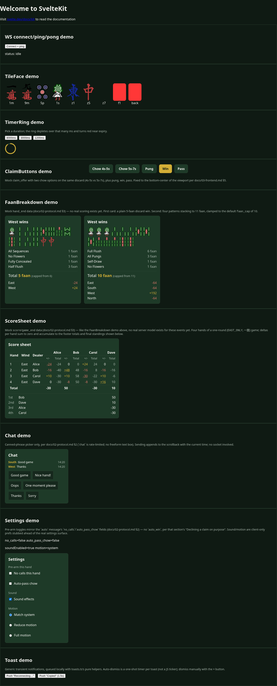

# 雀 — Browser Hong Kong Mahjong

Server-authoritative real-time multiplayer Hong Kong (Cantonese) mahjong. Bots fill empty seats
and take over for disconnected players.

**Stack:** Python 3.13 / FastAPI (REST + native WebSocket) · SvelteKit 2 + Svelte 5 (runes), DOM + SCSS · Postgres

## Quick start

```bash
cp .env.example .env
make up            # postgres + api + web
# web  http://localhost:5173
# api  http://localhost:8000/docs
make help          # everything else
```

## Screenshots

Captured from `/table/[id]`'s frozen mock-scenario fixture (`?mock=`), not a live game — repeatable
without a running backend, even though `/table/[id]` itself now opens a real one by default
(`docs/03-frontend.md`'s "`/table/[id]` wiring"). Regenerate with `pnpm --dir web run screenshots`
after any visible frontend change (see `.claude/skills/frontend-screenshots/SKILL.md`).

| | |
| --- | --- |
|  Home — component demos |  Lobby — create/join a room |
|  Table — your turn to discard |  Table — claim window open |
|  Table — hand ended, faan breakdown | |

## Planning docs

| Doc | Contents |
| --- | --- |
| [00-architecture.md](docs/00-architecture.md) | System design, room-as-actor model, scaling path |
| [01-rules-spec.md](docs/01-rules-spec.md) | Tiles, state machine, claim priority, faan table, payouts |
| [02-protocol.md](docs/02-protocol.md) | WebSocket envelope, message catalog, redaction, reconnect/resync, timers |
| [03-frontend.md](docs/03-frontend.md) | Svelte component layout, scene/DOM structure, asset pipeline, interaction model |
| [04-bots.md](docs/04-bots.md) | Bot tiers, shanten/ukeire, HK 3-faan trap, safety play, evaluation harness |
| [05-roadmap.md](docs/05-roadmap.md) | Milestones, testing strategy, risk register, resolved decisions |
| [06-ml.md](docs/06-ml.md) | Day-2. Constraints to honor now so training isn't a rewrite |
| [07-infra.md](docs/07-infra.md) | Monorepo layout, process model, Docker targets and profiles |

## Layout

```
server/   Python. mahjong_core/ (pure rules, stdlib-only) + app/ (FastAPI, rooms, WS) + bots/
web/      SvelteKit 2 + Svelte 5. Lobby and table, DOM throughout, styled with SCSS.
shared/   Generated protocol JSON schema (make proto)
docs/     Planning
```

`uv` owns Python, `pnpm` owns JS, `Makefile` is the seam.

## Compose profiles

| Command | Adds |
| --- | --- |
| `make up` | postgres, api, web |
| `make arena A=FaanBot B=EfficiencyBot N=20000` | one-shot bot evaluation |
| `docker compose --profile ml up trainer` | torch-enabled container (day 2) |

Only `ml` and `tools` profiles exist — no multi-node/`scale` profile yet ([docs/07-infra.md §3](docs/07-infra.md)).

> `--workers 1` on the API is load-bearing: rooms are in-memory objects owned by one process. [docs/07-infra.md §2](docs/07-infra.md)

## License

MIT — see [LICENSE](LICENSE). Bundled third-party assets (tile art) are attributed separately; see [docs/07-infra.md §8](docs/07-infra.md).
