# 0028. User account schema

- **Status:** Deferred
- **Date:** 2026-11-05

## Context

[ADR 0026](0026-optional-oauth-accounts.md) parks optional OAuth accounts and sketches their
tables in one row. This record lays out the full schema those accounts need. Guest play stays the
default; an account is opt-in. First scope:

| Feature | Guest | Signed in |
| --- | --- | --- |
| Past games | not listed: `players` in `games` is a JSON list of free-typed names, nothing ties a row to a person | "my games" list, joined through the user's seats |
| Learn progress | `mahjong:learnProgress:v1` and the endless scores, `localStorage` only ([ADR 0025](0025-learn-mode.md)), unchanged | stored server-side, synced across devices |
| Profile and stats | none | later: a `user_stats` row derived from the game links |

Auth itself (Authlib, Google sign-in, opaque session cookie in Postgres) follows ADR 0026 and
isn't repeated here.

## Design sketch

```mermaid
erDiagram
    users ||--o{ identities : "signs in with"
    users ||--o{ sessions : "has"
    users |o--o{ game_players : "sat in"
    games ||--|{ game_players : "seated"
    users ||--o{ learn_progress : "has"
    users ||--o{ learn_endless_scores : "has"
    users ||--o| user_stats : "future"

    users {
        uuid id PK
        varchar display_name "same cap and normalizer as guest names"
        jsonb prefs "synced settings, e.g. learn band, coachMarksDone"
        timestamptz created_at
        timestamptz learn_imported_at "last local upload, audit only"
        timestamptz training_consent_at "null = no consent"
        varchar consent_version "wording the user agreed to"
        timestamptz disabled_at "ban; null = active"
    }
    identities {
        uuid user_id FK
        varchar provider PK "google; more providers later"
        varchar subject PK "provider's stable user id"
        varchar email "nullable, contact only, never a key"
        timestamptz created_at
    }
    sessions {
        bytea id_hash PK "sha-256 of the cookie value"
        uuid user_id FK
        timestamptz created_at
        timestamptz last_used_at "idle expiry"
        timestamptz expires_at "absolute expiry"
    }
    games {
        int id PK "existing table"
        varchar mode "new: practice | multiplayer"
        jsonb players "4 display names, unchanged"
        jsonb result "hand_count, final_scores per seat"
        timestamptz created_at "persist time = game end"
    }
    game_players {
        int game_id PK,FK
        smallint seat PK "0-3"
        varchar kind "user | guest | bot"
        uuid user_id FK "null for guest, bot, or a deleted account"
        varchar bot_tier "BotTier, set iff kind = bot"
        int final_score "copy of result.final_scores[seat]"
        smallint placement "1-4, ties share a place"
    }
    learn_progress {
        uuid user_id PK,FK
        varchar lesson_id PK "static lesson id, e.g. basics-isolated-honour"
        boolean solved
        int attempts
        timestamptz solved_at
        int step "tutorial resume point, null for puzzles"
        boolean imported "value came from a local upload"
        timestamptz updated_at
    }
    learn_endless_scores {
        uuid user_id PK,FK
        varchar kind PK "PuzzleKind"
        int streak
        int best
        int solved
        boolean imported "value came from a local upload"
        timestamptz updated_at
    }
    user_stats {
        uuid user_id PK,FK
        int games_played
        int wins
        int self_draws
        int deal_ins
        int best_faan
        timestamptz updated_at
    }
```

### Tables

| Table | Key | Notes |
| --- | --- | --- |
| `users` | `id uuid` | uuid, not serial: ids appear in URLs (`/profile/<id>`) and shouldn't be enumerable. `display_name` starts as a placeholder (`Player 0427`), never the provider's profile name (usually a real name, and `games.players` outlives the account); the sign-up step asks for one. Editable, not unique, capped and normalized like a guest name (`MAX_NAME_LENGTH`, `server/app/names.py`) |
| `identities` | `(provider, subject)` | one user, many providers. `subject` is the provider's stable id, never the email. `email` is whatever the provider returns, nullable, not unique: used to contact the user and to match deletion requests, never to sign in or link accounts |
| `sessions` | `id_hash` | the cookie carries a 32-byte random token; only its SHA-256 is stored, so a DB leak can't replay sessions (no salt needed for a random token). Expires on `expires_at` or after an idle window on `last_used_at`; a new token is issued at every sign-in. `last_used_at` is written at most once an hour. Sign-out and revocation are a row delete |
| `game_players` | `(game_id, seat)` | exactly four rows per game, one per seat, saying who held it: an account, a guest or a bot |
| `learn_progress` | `(user_id, lesson_id)` | one row per `LessonProgress` entry (`web/src/lib/ui/settings-storage.ts`) |
| `learn_endless_scores` | `(user_id, kind)` | one row per `EndlessScore` entry; the endless `band` is a preference and lives in `users.prefs` |
| `user_stats` | `user_id` | future. A cache derived from `game_players` + `games.result`, rebuildable at any time; never the source of truth |

`games` already has what a "my games" list shows: `result.final_scores` per seat and `hand_count`
(`server/mahjong_core/state.py`), and `created_at`, written at `GAME_OVER`, is the end time.

### Columns added for later features

Cheap now, a backfill or a migration on a large table later.

| Column | Why | Set by |
| --- | --- | --- |
| `game_players.final_score`, `placement` | stats ("average placement", "wins") become indexed queries instead of JSON reads, which may make `user_stats` unnecessary | `save_game_record`, from `game_outcome(state).final_scores`; tied scores share the better placement |
| `games.mode` | "my games" filter, and practice games must stay out of multiplayer stats and any rating. Derivable from seat kinds, but not cleanly once a human seat goes `autoplay` | `Table.practice`, at save time. Nullable: existing rows stay null (unknown), since `players` can't tell a practice bot seat from an unfilled one |
| `users.training_consent_at`, `consent_version` | [ADR 0016](0016-human-records-as-training-data.md) needs consent before human games become training data; recording which wording was agreed lets the wording change later | the consent toggle in account settings. Null = no consent; withdrawing sets it back to null |
| `users.disabled_at` | a ban flag for public multiplayer | an operator, by SQL for now. A disabled user can't sign in, and setting it deletes their sessions |
| `identities.email` | support contact and deletion requests | the OAuth callback, from the provider's profile, refreshed on each sign-in |

### Why `game_players` and not a foreign key on `games`

A game has four seats, so a single `games.user_id` can't express it, and four `seatN_user_id`
columns make "my games" an `OR` across four indexes. The join table:

- answers "my games" with one index scan (see Indexes);
- leaves the existing `games` columns unchanged;
- gives account deletion a clean cut (see Foreign keys).

`save_game_record` commits on its own (`server/app/db/records.py`), so it gains a `seats=`
parameter and adds the four `game_players` rows before that commit, in one transaction.

### Guests and bots in `game_players`

Guests and bots get a seat row but never a `users` row: a guest has no stable identity to key on,
and bot "users" would leak into every user query.

| `kind` | `user_id` | `bot_tier` | Name shown |
| --- | --- | --- | --- |
| `user` | set, or null once the account is deleted | null | `games.players[seat]` |
| `guest` | null | null | `games.players[seat]` |
| `bot` | null | set | the tier's display name |

Constraints: `CHECK (seat BETWEEN 0 AND 3)`, `CHECK (kind IN ('user', 'guest', 'bot'))`, and a
pairing `CHECK`: `guest` has neither id nor tier, `bot` has a tier and no id, `user` has no tier.
`kind = 'user' AND user_id IS NULL` is legal and means a deleted account, still distinguishable
from a guest. Names stay in `games.players` only, never copied into `game_players`.

The `kind` column is needed because `games.players` alone can't tell the seats apart: a bot seat
and an empty seat are both `None`, and a guest and a signed-in user are both a bare name. Stats
need it: a win against Expert bots and a win against three guests are different numbers, and a
rating must count only `user` opponents.

`kind` follows the seat's `SeatBinding`, the same rule `_persist_game_record` already uses for
`players`: `bot` only for a seat bound to a bot from table construction (`status == "bot"`). A
human who disconnects and is finished by `autoplay` keeps their own `kind` and `user_id`, so the
game still appears in their list.

Where the values come from at save time:

| Value | Source |
| --- | --- |
| `user_id` | new `SeatBinding.user_id: UUID \| None`, set at `join` from the session cookie the WS handshake carries ([ADR 0026](0026-optional-oauth-accounts.md)) |
| `bot_tier` | `Table._effective_bot_tier(seat)`; `SeatBinding` has no tier |
| seat name | a signed-in `join` defaults to `users.display_name`, through the same normalizer as a guest name |

Games saved before this ships get no `game_players` rows. No backfill: no accounts existed then,
and `None` in old `players` can't be split into bot or empty.

### Foreign keys

| FK | On delete |
| --- | --- |
| `identities.user_id`, `sessions.user_id`, `learn_*.user_id`, `user_stats.user_id` → `users.id` | `CASCADE` |
| `game_players.user_id` → `users.id` | `SET NULL`; `kind` stays `user` |
| `game_players.game_id` → `games.id` | `CASCADE` |

Deleting an account removes the user, its identities, sessions, learn progress and stats. Its
seats in past games keep `kind = 'user'` with a null `user_id`: the game and the name typed at the
table (`games.players[seat]`) stay for the other players and for training data, but nothing links
them back to the deleted account.

`learn_progress.lesson_id` and `learn_endless_scores.kind` are not foreign keys: lessons are
static JSON emitted by `make proto`, not rows. A lesson removed or re-mined later leaves stale rows,
which the read path filters out the same way `loadLearnProgress` drops unknown ids today.

### Indexes

Postgres doesn't index FK columns, and every user delete cascades through them.

| Index | Serves |
| --- | --- |
| `game_players (user_id, game_id DESC) WHERE user_id IS NOT NULL` | "my games", newest first; user-delete `SET NULL` |
| `sessions (user_id)` | sign-out everywhere; user-delete cascade |
| `sessions (expires_at)` | expired-session cleanup job |
| `identities (user_id)` | user-delete cascade; listing linked providers |

### Types and tests

Tests run on SQLite via aiosqlite, so the models use portable types, matching `JSONType`'s
approach in `server/app/db/models.py`:

| Need | Type |
| --- | --- |
| uuid | `sa.Uuid`, Python-side `default=uuid.uuid4` (no server default: SQLite has none; `uuid7` needs Python 3.14, pinned to 3.13) |
| session hash | `LargeBinary(32)` |
| `kind`, `bot_tier`, `games.mode` | `String(8)`, `String(16)`, `String(16)` |
| constraints | `CheckConstraint`, works on both |

SQLite ignores foreign keys unless `PRAGMA foreign_keys=ON`. `make_engine` sets it in a `connect`
event listener for SQLite, or the `CASCADE`/`SET NULL` behaviour goes untested.

### Learn progress: guest vs signed in

Guests keep today's behaviour: progress lives in `localStorage` and never reaches the server. The
web reads and writes through one progress store with two backends, `localStorage` for a guest and
the API for a signed-in user.

On first sign-in on a device, the client offers to upload its local progress once
(`mahjong:learnProgress:v1`, `mahjong:learnEndless:v1`). On the server's success response it
deletes both keys; on failure it keeps them and offers again next sign-in. From then on a
signed-in device writes only to the API, never back to `localStorage`. Each device uploads once;
a second device's upload merges like the first. The server merges per key:

| Field | Merge rule |
| --- | --- |
| `solved` | `OR` |
| `attempts` | max |
| `solved_at` | earliest non-null |
| `step` | max |
| endless `best`, `solved` | max |
| endless `streak` | server value; the local value only when the server has no row |

A row's `imported` becomes true when any merged field took the uploaded value. Replaying the same
upload changes nothing, since every rule is a max or an `OR`.

Signing out leaves the server copy in place; the device starts a fresh, empty `localStorage`
record as a guest.

Past guest games can't be claimed: a guest seat has no proof of who sat there once its
`reconnect_secret` is gone.

### Trusting the upload

The upload is client data and can be edited before sign-in. It can't be made tamper-proof: any
signing key for `localStorage` would ship in the client bundle. It doesn't need to be:

- **Nothing to gain today.** Every puzzle's answer key is already public static JSON
  ([ADR 0025](0025-learn-mode.md)), so forging `solved` gets nothing that reading the key doesn't.
- **Validate and clamp** what's uploaded; reject the entry, not the whole upload:

  | Rule | Check |
  | --- | --- |
  | known lesson | `lesson_id` in the current catalog, `kind` a `PuzzleKind` |
  | consistent | `solved` implies `attempts >= 1`; `streak <= best <= solved` |
  | bounded | counts capped; `solved_at` not in the future |
  | size | body size capped; uploads rate-limited per user; `users.learn_imported_at` records the last one |

- **Tag it.** `imported` on `learn_progress` and `learn_endless_scores` marks rows whose values
  came from an upload. Anything competitive later (endless leaderboard, achievements) ignores
  imported rows; a later server-recorded solve or better score clears the flag.

If a learn score ever carries real stakes, the fix is server-graded attempts (ADR 0025 option B),
not a cleverer upload.

## Needs before reviving

- Everything in [ADR 0026](0026-optional-oauth-accounts.md)'s "Needs before reviving" (superseding
  ADR 0001, privacy policy, deletion path, rate limits).
- **Past games are a list only.** It reads `games.result` and `created_at`. Opening a full replay
  stays deferred with [ADR 0011](0011-replay-viewer.md).
- **Migrations:** one Alembic revision per phase below; `user_stats` waits for the profile page.
  Prod applies them with `make prod-migrate` ([infra.md §6](../infra.md)) before the new code
  takes traffic.

## Implementation plan

Each phase is shippable on its own and ends in a review pause. Phase 1 needs no auth at all, so
seat records start filling before any user sees an account.

| Phase | Ships | Depends on |
| --- | --- | --- |
| 0 | decisions, provider apps | — |
| 1 | seat records for every game (`game_players`, `games.mode`) | — |
| 2 | server auth: sign-in, sessions, `/me`, delete | 0 |
| 3 | web sign-in UI, account settings, consent | 2 |
| 4 | "my games" list | 1, 3 |
| 5 | learn progress sync and one-time upload | 3 |
| 6 | stats and profile (later) | 4 |
| 7 | privacy policy and terms; sign-in enabled publicly | 3 |

### Pull requests

Each phase lands as several PRs. Rules for every PR:

- one concern; a refactor never shares a PR with a behaviour change;
- tests and the docs it touches ship in the same PR; CI green;
- deployable alone: prod keeps working if the next PR never lands;
- a migration ships in a PR whose code doesn't yet *require* the new tables, so the auto-deploy
  can run before `make prod-migrate` without breaking saves;
- server auth routes stay off in prod behind `ACCOUNTS_ENABLED` (unset → `/auth/*` and `/me*`
  404), the web UI behind the matching flag, until phase 7;
- rough size: under ~400 changed lines, excluding lockfiles and generated files.

| PR | Phase | Scope | Size |
| --- | --- | --- | --- |
| 0.1 | 0 | ADR: optional accounts, superseding 0001; `Superseded` status row | S |
| 1.1 | 1 | `make_engine`: SQLite `PRAGMA foreign_keys=ON`, with a test | S |
| 1.2 | 1 | `game_players` model + migration, `games.mode` nullable; constraint tests; nothing writes yet | S |
| 1.3 | 1 | `save_game_record(seats=, mode=)`, placement; `_persist_game_record` fills them; `architecture.md`, `infra.md §6` | M |
| 2.1 | 2 | remove `JWT_SECRET` (env, Compose, CI, docs) and `pyjwt` | S |
| 2.2 | 2 | `users`, `identities`, `sessions` models + migration; `game_players.user_id` FK; indexes | M |
| 2.3 | 2 | `ACCOUNTS_ENABLED`; session module (issue, hash, resolve, idle/absolute expiry, rotation, cleanup); credentialed CORS; `GET /me`, `POST /auth/logout`. Testable without Google | M |
| 2.4 | 2 | Authlib; `/auth/google/login` + callback (upsert user/identity, email); rate limits; env vars in `infra.md §2` | M |
| 2.5 | 2 | `PATCH /me`, `DELETE /me`, `GET /me/export`; deletion cascade tests | M |
| 2.6 | 2 | WS handshake resolves the cookie; `SeatBinding.user_id`, account name, `kind = 'user'` on save; `architecture.md §2.1` | M |
| 2.7 | 2 | `httpx` → `httpx2` (Authlib ≥ 1.8 and Starlette's `TestClient` deprecate `httpx`); `httpx` dropped | S |
| 3.1 | 3 | web flag; session store (`/me` on load, client-side only, `credentials: 'include'`) | S |
| 3.2 | 3 | Google sign-in button, sign-out, first-sign-in step (name, consent) | M |
| 3.3 | 3 | account settings: name, consent, export, delete; screenshots | M |
| 3.4 | 3 | signed-in join hides the name field | S |
| 4.1 | 4 | `GET /me/games` (keyset pages, mode filter); `protocol.md §10` | S |
| 4.2 | 4 | `/profile` games list | M |
| 5.1 | 5 | learn tables + migration; `GET /me/learn`, `PUT` lesson and endless rows | M |
| 5.2 | 5 | `POST /me/learn/import`: validate, clamp, merge, `imported`, rate limit | M |
| 5.3 | 5 | web refactor: progress store behind a backend interface, `localStorage` only; no behaviour change | S |
| 5.4 | 5 | web API backend; upload once per device, delete keys on success | M |
| 7.1 | 7 | privacy policy and terms pages, final consent wording | M |
| 7.2 | 7 | enable both flags in prod; ADR statuses flip | S |

Phase 6 is unscheduled and gets its own breakdown when it's picked up.

### Phase 0: decisions and setup

No code. Unblocks phase 2.

- [x] New ADR superseding [ADR 0001](0001-guest-only-identity.md): optional accounts,
      [ADR 0029](0029-optional-accounts.md) (add `Superseded` to the status table in `README.md`;
      statuses flip in phase 7).
- [ ] Google Cloud project + OAuth client (web application):
      - scopes `openid email` only (non-sensitive, so no scope verification; `profile` was
        dropped with the placeholder display name);
      - redirect URIs `https://mahjong-api.shumshum.dev/auth/google/callback` and
        `http://localhost:8000/auth/google/callback`;
      - authorized domain `shumshum.dev`;
      - consent screen publishing status set to **In production** (Testing caps sign-in to the
        listed test users);
      - client id and secret in the prod `.env` and `.env.example` ([infra.md §2](../infra.md)).
- [ ] Brand verification (app name and logo on the consent screen) needs a privacy policy URL and
      a verified `shumshum.dev` in Search Console: submitted in phase 7.

### Decisions

| Topic | Decision |
| --- | --- |
| Provider | Google only at launch. `identities` keeps its multi-provider shape; linking a second provider is moot until one is added |
| Cookie origin | web (`mahjong.shumshum.dev`) and API (`mahjong-api.shumshum.dev`) are separate hostnames of one site, each a Cloudflare Tunnel ingress rule, no reverse proxy. The session cookie is host-only on the API host, `HttpOnly`, `Secure`, `SameSite=Lax` (same site, so it rides credentialed fetches and the WS handshake). Web `fetch`es to the API use `credentials: 'include'`; the API sets `allow_credentials=True` with explicit `CORS_ORIGINS`, never `*`. The web reads `/me` client-side only: its SSR never receives an API-host cookie |
| Session lifetime | 90 days absolute (`expires_at`), 30 days idle (`last_used_at`) |
| Seat name | a signed-in seat always uses `users.display_name`; the table's name field is hidden and any typed `join.name` is ignored |
| Email | request the provider's email scope; stored in `identities.email` |
| Training consent | asked at sign-up, unchecked by default; changeable later in account settings |
| Account deletion | immediate, after a typed confirmation; no grace period |
| Data export | `GET /me/export`: the user's row, identities, games list and learn progress as JSON |
| Cross-device seat reclaim | deferred; seats keep the per-browser `reconnect_secret` |
| Signed-in badge for other players | none; v1 sends nothing new on the wire |
| Privacy policy and terms | written last (phase 7); sign-in isn't publicly enabled until it ships |
### Phase 1: seat records for every game

Server only. No accounts yet, so every row is `guest` or `bot`, but every game from here on has
seat data, placements and mode.

- [x] Migration: `game_players` (with `final_score`, `placement`, constraints, the `user_id`
      column and index, FK to `users` added in phase 2), `games.mode` nullable.
- [x] `make_engine`: `PRAGMA foreign_keys=ON` for SQLite.
- [x] `save_game_record(..., seats=)`: writes four rows before its commit; computes `placement`
      from `final_scores`. `seats` stays optional: `bots/selfplay.py`'s bot-only games have no
      tiers to record and write no seat rows; every `Table` game passes them.
- [x] `_persist_game_record`: builds `seats` from `seat_bindings` (`kind`) and
      `_effective_bot_tier` (`bot_tier`); passes `mode` from `Table.practice`.
- [x] Tests (failing first): four rows per saved game; kind/tier for practice, multiplayer and
      `autoplay` seats; tied placements; CHECK rejects a bad pairing; FK cascade from `games`.
- [x] Docs: `architecture.md` storage rows (§6, §2), `infra.md §6` tables list.
- `make test-server`.

### Phase 2: server auth

- [x] Dependency: Authlib (reason: OAuth 2.0 + PKCE + `state`, maintained; replaces
      hand-rolled token exchange), with `httpx` (Authlib's async client) moved from dev to
      runtime; replaced by `httpx2`, Authlib's and Starlette's supported fork, in PR 2.7. Remove `JWT_SECRET` and `pyjwt` if nothing else reads them (done, PR 2.1).
- [x] Migration: `users`, `identities`, `sessions`, indexes; add the `game_players.user_id` FK.
      `users.prefs` and `learn_imported_at` wait for phase 5's migration.
- [x] Routes (`{provider}` is only `google` for now): `GET /auth/{provider}/login`, `GET /auth/{provider}/callback` (upsert user +
      identity, refresh `email`, create session, set cookie, redirect to the web), `POST
      /auth/logout`, `GET /me`, `PATCH /me` (display name, consent), `DELETE /me`,
      `GET /me/export`.
- [x] CORS: `allow_credentials=True`, explicit origins.
- [x] No hostname in code or rows: the callback URL, post-sign-in redirect and cookie host derive
      from env (`PUBLIC_API_URL`, `PUBLIC_WEB_URL` defaulting to the first `CORS_ORIGINS`
      entry), so a domain change is config only.
- [x] Sessions: 32-byte token, SHA-256 stored, 90-day absolute and 30-day idle expiry, rotate at sign-in,
      `last_used_at` written at most hourly, periodic cleanup of expired rows. `disabled_at`
      refuses sign-in and drops sessions.
- [x] WS: resolve the cookie at the handshake; `join` sets `SeatBinding.user_id` and the name to
      `users.display_name`, ignoring `join.name`. `_persist_game_record` writes `kind = 'user'`.
- [x] Rate limits on `/auth/*` with the existing `RateLimiter` (`app/main.py`).
- [x] Tests: callback with a stubbed provider token exchange; session expiry, idle, rotation;
      disabled user; `DELETE /me` cascades and leaves `game_players` as `user` + null id; WS join
      with and without a cookie.
- [x] Docs: `architecture.md §2.1` rewritten (guest *or* account), `protocol.md §10` new HTTP
      routes, `infra.md §2` new env vars (provider client ids/secrets, session lifetimes).
- `make test-server`.

### Phase 3: web sign-in

- [x] Session store: `GET /me` on load; signed-in / guest state available app-wide. API
      `fetch`es use `credentials: 'include'`. Client-side only, not SSR: the host-only cookie
      never reaches the web host, so there is nothing to forward
      ([frontend.md §6](../frontend.md) "Account session").
- [x] "Sign in with Google" button (Google's branding rules) in settings and on `/profile`;
      sign-out.
- [x] Sign-up step on first sign-in: confirm display name, training-consent checkbox (unchecked).
- [x] Account settings: display name, training-consent toggle, export data, delete account with
      a typed confirmation (the display name, on `/profile`).
- [x] Signed-in players see no name field when joining a table.
- [x] Sign-in stays behind a flag (hidden in prod) until phase 7: `PUBLIC_ACCOUNTS_ENABLED`.
- [x] i18n: en + zh-Hant for every new string.
- [x] e2e: guest flow unchanged; signed-in flow against a stubbed `/me`.
- [x] Docs: `frontend.md §6` (client state), `§7` (routes). Screenshots unchanged: the screenshot
      server runs flag-off and `/profile` isn't a notable page; an account shot waits for phase 7.
- `make test-web`, then `make test` (touches both sides through `/me`).

### Phase 4: "my games"

- [x] `GET /me/games?before=<game_id>&mode=`: keyset-paginated, newest first, from
      `game_players` joined to `games`; returns date, mode, hand count, own placement and score,
      and the other three seats (name or bot tier).
- [x] `/profile` lists them. No replay link ([ADR 0011](0011-replay-viewer.md) stays deferred).
- [x] Tests: pagination, mode filter, only the caller's games, deleted-account seats render as a
      name only.
- [x] Docs: `protocol.md §10`, `frontend.md §6`, `§7`. Screenshots unchanged, as in phase 3.
- `make test`.

### Phase 5: learn progress sync

- [x] Migration: `learn_progress`, `learn_endless_scores`, `users.prefs`,
      `users.learn_imported_at`. The two `users` columns stay off the `User` mapper (read with
      Core), so sign-in and `/me` keep working on code deployed before `make prod-migrate`.
- [x] Routes: `GET /me/learn`, `PUT /me/learn/{lesson_id}`, `PUT /me/learn/endless/{kind}`;
      `PATCH /me` prefs; learn progress in `GET /me/export` (PR 5.1). A `PUT` never lowers
      `solved`, `attempts`, `best` or `solved` (a second device's stale copy).
- [x] `POST /me/learn/import` (validate, clamp, merge, set `imported`; PR 5.2). Counts above the
      cap are clamped; every other failing entry is dropped and counted. Prefs merge too: an
      uploaded pref fills an unset key, `coach_marks_done` ORs.
- [ ] Web: one progress store with a `localStorage` backend (guest) and an API backend (signed
      in). After sign-in, offer the upload once per device; delete both local keys only on success.
- [ ] Tests (server): every merge rule; replayed upload is a no-op; each validation rule drops
      the entry, not the upload; rate limit. (web): backend switch, keys deleted on success and
      kept on failure.
- [ ] Docs: [ADR 0025](0025-learn-mode.md) storage note, `frontend.md §6`, `protocol.md §10`.
- `make test`.

### Phase 6: stats and profile (later)

Not scheduled. First try plain queries over `game_players` (games played, wins, average
placement, practice vs multiplayer); add `user_stats` only if those get slow.

### Phase 7: privacy policy and terms, public launch

- [ ] Privacy policy: what's stored (provider subject, email, display name, games, learn
      progress), why, how long, training consent, export and deletion.
- [ ] Terms of use.
- [ ] Final training-consent wording; bump `consent_version` if it changed from the phase 3
      placeholder.
- [ ] Routes for both pages, linked from sign-up and account settings; en + zh-Hant.
- [ ] Add both URLs to the Google consent screen; verify `shumshum.dev` in Search Console and
      submit brand verification.
- [ ] Remove the sign-in flag; mark ADR 0001 `Superseded`, 0026, 0029 and this record `Accepted`.
